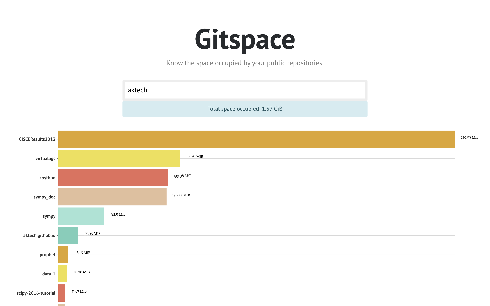

# Gitspace

[](https://github.com/aktech/gitspace/actions/workflows/test.yml)

A simple app to know the space occupied by your public repositories: https://gitspace.io



## Running the app locally

* Install Node.js (>=20) and pnpm (>=10). With Corepack enabled (`corepack enable`), the `packageManager` field in `package.json` will activate the correct pnpm version automatically.
* Install dependencies

```bash
pnpm install --frozen-lockfile
```

* Run the app locally

```bash
pnpm start
```

Checkout: http://localhost:3000/

## Deploy to github pages

```bash
pnpm deploy
```
